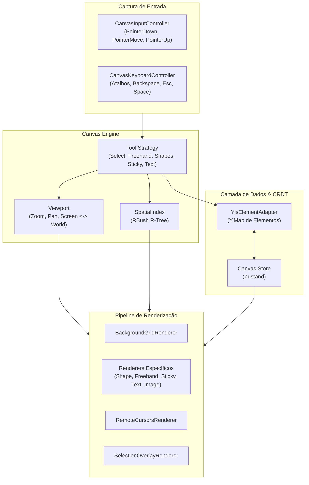

# 🖥️ Whiteboard - Frontend (Next.js & Canvas Studio)

> Aplicação web de ponta construída com Next.js 16 (App Router), React 19, Tailwind CSS v4 e uma engine de Canvas 2D proprietária de alta performance. Conta com sincronização em tempo real via Yjs CRDT sobre WebSockets, internacionalização nativa (i18n), gerenciamento de estado reativo com Zustand e indexação espacial RBush.

[](https://www.typescriptlang.org/)
[](https://nextjs.org/)
[](https://react.dev/)
[](https://tailwindcss.com/)
[](https://github.com/pmndrs/zustand)
[](https://playwright.dev/)
[](https://vitest.dev/)

---

<div align="center">
  
  <p><em>Arquitetura da engine de canvas 2D proprietária, renderização em 3 camadas, indexação espacial e CRDT local</em></p>
</div>

---

## 📋 Sobre o Projeto

O **Whiteboard Frontend** é a interface visual interativa da plataforma de colaboração. O projeto foi arquitetado do zero para oferecer uma experiência fluida de desenho e organização espacial similar a ferramentas consagradas de design gráfico e ideação.

---

## 🧱 Arquitetura da Canvas Engine

A renderização foi estruturada de forma desacoplada para garantir manutenibilidade e alta taxa de quadros (60 FPS):



---

## 🔄 Colaboração em Tempo Real

A comunicação em tempo real acontece via WebSockets e foi projetada com foco em segurança e performance:

1. **Obtenção do Ticket de Acesso**: O cliente solicita à API REST (`POST /v1/boards/:id/ws-ticket`) um ticket de acesso temporário (30 segundos).
2. **Handshake WebSocket**: O cliente conecta-se ao Collab Server (`ws://localhost:3002`) enviando o ticket gerado.
3. **Sincronização de Estado (Yjs Sync Protocol)**: Troca de mensagens binárias compactadas baseadas no protocolo oficial `y-protocols`:
   - `SyncStep1`: O cliente envia seu estado local para o servidor.
   - `SyncStep2`: O servidor responde com os deltas pendentes.
   - `Update`: Atualizações contínuas de elementos são propagadas em tempo real.
4. **Awareness Protocol**: Transmissão em alta frequência do cursor do mouse, seleção ativa e dados do perfil para os demais usuários conectados na mesma sala.

---

## 🤝 Sincronização de Contrato com o Backend

O frontend consome schemas, constantes e tipagens geradas diretamente a partir do código do backend.

> ⚠️ **Atenção**: As pastas `src/shared/` e `fixtures/protocol/` são réplicas da fonte da verdade (que reside em `../backend/src/shared`). Não edite esses arquivos manualmente no frontend!

### Comandos de Sincronização:

```bash
# Copia as definições do backend para o frontend
npm run sync:shared

# Verifica no pipeline de CI se há divergência (drift) entre os repositórios
npm run sync:shared:check

# Gera os tipos TypeScript a partir do Swagger/OpenAPI da API REST (com backend rodando)
npm run gen:api
```

---

## 🚀 Início Rápido

### Pré-requisitos

- [Node.js](https://nodejs.org/) 22 ou superior
- [npm](https://www.npmjs.com/) 10 ou superior
- Backend e dependências ativas (consulte o [README raiz](../README.md))

### Instalação e Execução

1. **Acesse a pasta do frontend**

   ```bash
   cd frontend
   ```

2. **Instale as dependências**

   ```bash
   npm ci
   ```

3. **Configure as variáveis de ambiente locais**

   ```bash
   cp .env.example .env.local
   ```

4. **Sincronize os arquivos compartilhados com o backend**

   ```bash
   npm run sync:shared
   ```

5. **Inicie o servidor de desenvolvimento**

   ```bash
   npm run dev
   ```

6. **Abra no navegador**
   Acesse: [http://localhost:3000](http://localhost:3000)

---

## 📦 Estrutura do Projeto

```text
frontend/
├── src/
│   ├── app/                      # Next.js App Router (Páginas, Layouts e Rotas de API)
│   │   ├── (auth)/               # Telas de login e registro
│   │   ├── board/[id]/           # Página do Whiteboard Studio interativo
│   │   ├── boards/               # Dashboard de gerenciamento de quadros
│   │   └── api/health/           # Endpoint interno de verificação de integridade
│   │
│   ├── canvas/                   # Engine proprietária do Canvas 2D
│   │   ├── controllers/          # Controladores de eventos de mouse, touch e teclado
│   │   ├── renderers/            # Renderizadores especializados (grid, formas, texto, sticky, etc.)
│   │   ├── repositories/         # YjsElementRepository para mutações no Y.Doc
│   │   ├── tools/                # Estratégias das ferramentas gráficas (select, freehand, shapes, etc.)
│   │   ├── alignment-helper.ts   # Snapping magnético e guias de alinhamento
│   │   ├── connector-helper.ts   # Cálculo de âncoras e amarração dinâmica de setas
│   │   ├── spatial-index.ts      # Aceleração espacial com RBush (R-Tree)
│   │   ├── viewport.ts           # Transformação matricial, pan e zoom
│   │   └── canvas-engine.ts      # Loop principal e orquestrador gráfico
│   │
│   ├── collab/                   # Módulo de comunicação e colaboração
│   │   ├── sync-provider.ts      # Cliente WebSocket para o protocolo Yjs
│   │   ├── typed-awareness.ts    # Propagação e escuta de cursores e estados remotos
│   │   └── undo-manager.ts       # Histórico de ações (Undo/Redo) isolado
│   │
│   ├── components/               # Componentes visuais reutilizáveis
│   │   ├── brand/                # Logotipos e identidade visual do Whiteboard
│   │   ├── preferences/          # LanguageSwitcher e controles de preferência
│   │   └── ui/                   # Componentes base acessíveis (Radix UI + Tailwind)
│   │
│   ├── features/                 # Módulos verticais de negócio
│   │   ├── auth/                 # Formulários e sessão de autenticação
│   │   ├── boards/               # Cards, listagem e diálogos de criação de quadros
│   │   ├── studio/               # Barras de ferramentas, minimapa, seletores de cor e atalhos
│   │   ├── share/                # Modal de compartilhamento e links públicos com senha
│   │   ├── export/               # Diálogo e serviços de exportação PNG/SVG/JSON
│   │   └── version-history/      # Visualização e restauração de snapshots
│   │
│   ├── i18n/                     # Internacionalização (pt-BR e en-US)
│   ├── lib/                      # Cliente HTTP Axios, cookies e configurações
│   ├── providers/                # Provedores de contexto (Theme, React Query, etc.)
│   ├── shared/                   # Réplica sincronizada do contrato com o backend
│   └── store/                    # Gerenciamento de estado global com Zustand
│
├── tests/                        # Testes automatizados
│   ├── unit/                     # Testes unitários de canvas, helpers e matemática
│   ├── contract/                 # Testes de integridade do contrato compartilhado
│   └── e2e/                      # Testes ponta a ponta com Playwright
│
├── docker/                       # Dockerfile standalone para produção
├── playwright.config.ts          # Configurações do Playwright
├── vitest.config.mts             # Configurações do Vitest
└── package.json
```

---

## 🔧 Configuração de Ambiente

Crie o arquivo `.env.local` na raiz da pasta `frontend/`:

```env
# URL da API REST do backend
NEXT_PUBLIC_API_URL=http://localhost:3001

# URL do servidor WebSocket Collab
NEXT_PUBLIC_WS_URL=ws://localhost:3002
```

| Variável              | Padrão                  | Descrição                                                            |
| :-------------------- | :---------------------- | :------------------------------------------------------------------- |
| `NEXT_PUBLIC_API_URL` | `http://localhost:3001` | Endereço base da API REST para requisições de login, boards e upload |
| `NEXT_PUBLIC_WS_URL`  | `ws://localhost:3002`   | Endereço do gateway WebSocket para colaboração em tempo real         |

---

## 📝 Scripts Disponíveis

```bash
# Desenvolvimento
npm run dev                 # Inicia o servidor Next.js em modo de desenvolvimento (porta 3000)

# Build e Produção
npm run build               # Executa a compilação de produção com output standalone
npm run start               # Inicializa o servidor de produção compilado

# Sincronização de Contratos
npm run sync:shared         # Sincroniza schema e tipos copiando de ../backend/src/shared
npm run sync:shared:check   # Verifica se o shared está 100% atualizado com o backend (CI)
npm run gen:api             # Gera o cliente tipado TypeScript a partir do OpenAPI do backend

# Qualidade de Código & Testes
npm run lint                # Executa o linter ESLint (Next.js core rules)
npm run format              # Formata os arquivos do projeto com Prettier
npm run typecheck           # Verifica inconsistências de tipagem TypeScript (tsc --noEmit)
npm run test                # Executa os testes unitários e de contrato com Vitest
npm run test:e2e            # Roda a suíte completa de testes E2E com Playwright
```

---

## 🐳 Construção com Docker

O frontend pode ser encapsulado em uma imagem leve otimizada via modo `output: 'standalone'` do Next.js:

```bash
# Construir imagem Docker
docker build -f docker/Dockerfile -t wb-web \
  --build-arg NEXT_PUBLIC_API_URL=http://localhost:3001 \
  --build-arg NEXT_PUBLIC_WS_URL=ws://localhost:3002 .

# Executar container localmente
docker run -p 3000:3000 wb-web
```

> **Healthcheck**: O endpoint interno `GET /api/health` é exposto para monitoramento em ambientes orquestrados (Kubernetes / Docker Compose).
