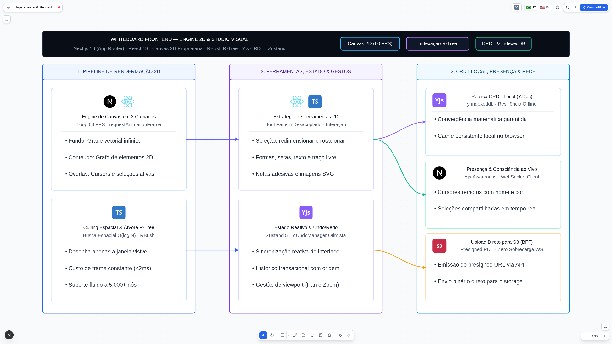
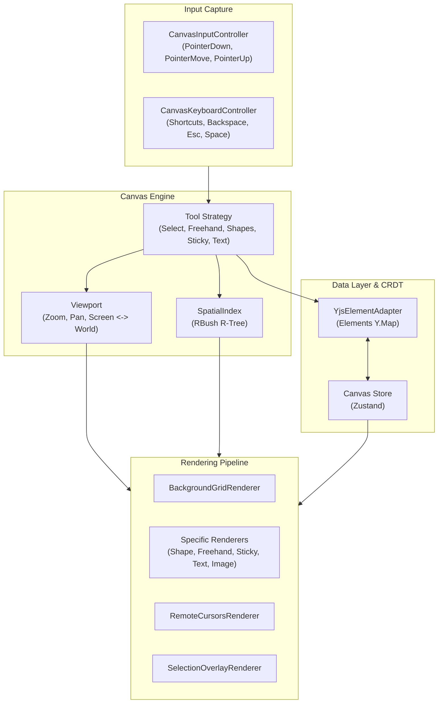

# 🖥️ Whiteboard — Frontend (Next.js & Canvas Studio)

> State-of-the-art web application built with Next.js 16 (App Router), React 19, Tailwind CSS 4, and a proprietary high-performance 2D Canvas Engine. Features real-time multi-user collaboration via Yjs CRDT over WebSockets, native internationalization (i18n), reactive state management with Zustand, and RBush R-Tree spatial indexing.

[](https://www.typescriptlang.org/)
[](https://nextjs.org/)
[](https://react.dev/)
[](https://tailwindcss.com/)
[](https://github.com/pmndrs/zustand)
[](https://playwright.dev/)
[](https://vitest.dev/)

---

<div align="center">
  
  <p><em>Custom 2D canvas engine architecture, 3-layer rendering pipeline, spatial indexing, and local CRDT replica</em></p>
</div>

---

## 📋 About The Submodule

The **Whiteboard Frontend** is the client application and visual studio of the platform. The project was architected from scratch to provide a fluid, lag-free drawing and spatial ideation experience comparable to industry-standard graphic design tools.

---

## 🧱 Canvas Engine Architecture

Rendering is organized into decoupled layers to maintain high maintainability and a steady 60 FPS frame rate:



---

## 🔄 Real-Time Collaboration

Real-time synchronization runs over WebSockets and is designed for maximum resilience and low latency:

1. **Access Ticket Acquisition**: The client requests a temporary, single-use ticket (30-second TTL) from the REST API (`POST /v1/boards/:id/collab-token`).
2. **WebSocket Handshake**: The client connects to the Collab Server (`ws://localhost:3002/collab`) presenting the ticket.
3. **CRDT State Synchronization (Yjs)**: Binary message exchange via standard `y-protocols`:
   - `SyncStep1`: Client sends its local State Vector to the server.
   - `SyncStep2`: Server responds with missing deltas.
   - `Update`: Continuous real-time element modifications are broadcast to peers.
4. **Awareness Protocol**: High-frequency streaming of cursor coordinates (smoothed via LERP interpolation at ~30Hz), active selection bounds, and user presence.

---

## 🤝 Shared Contract Synchronization with Backend

The frontend consumes schemas, constants, and types derived directly from the backend authoritative source of truth.

> ⚠️ **Warning**: The `src/shared/` and `fixtures/protocol/` directories are synchronized replicas. **Never edit these files directly in the frontend repository.**

### Contract Synchronization Commands:
```bash
# Copy latest shared definitions from backend
npm run sync:shared

# Verify parity in CI pipeline
npm run sync:shared:check

# Generate typed TypeScript client from backend OpenAPI Swagger
npm run gen:api
```

---

## 🚀 Quickstart

### Prerequisites
- [Node.js](https://nodejs.org/) `20.x` or `22.x`
- [npm](https://www.npmjs.com/) `10.x+`
- Backend and infrastructure services running (see root [README.md](../README.md))

### Installation & Execution
```bash
# 1. Install dependencies
npm ci

# 2. Copy local environment variables
cp .env.example .env.local

# 3. Synchronize shared contracts from backend
npm run sync:shared

# 4. Start Next.js development server
npm run dev
```

Visit [http://localhost:3000](http://localhost:3000) in your browser.

---

## 📝 Available Scripts

```bash
# Development
npm run dev              # Starts Next.js development server on port 3000
npm run build            # Builds production Next.js application
npm run start            # Starts production Next.js server

# Contracts & API Generation
npm run sync:shared      # Copies shared contracts from backend/src/shared
npm run sync:shared:check # Asserts parity between backend and frontend contracts
npm run gen:api          # Generates typed TypeScript API client from OpenAPI spec

# Quality & Testing
npm run lint             # Runs ESLint (Next.js core rules)
npm run format           # Formats source code with Prettier
npm run typecheck        # Runs strict TypeScript validation (tsc --noEmit)
npm run test             # Runs Vitest unit & contract test suites (118 tests)
npm run test:e2e         # Runs full end-to-end browser test suite with Playwright
```

---

## 🐳 Docker Deployment

The frontend can be built as a lightweight standalone container:

```bash
# Build standalone Docker image
docker build -f docker/Dockerfile -t wb-web \
  --build-arg NEXT_PUBLIC_API_URL=http://localhost:3001 \
  --build-arg NEXT_PUBLIC_WS_URL=ws://localhost:3002 .

# Run container locally
docker run -p 3000:3000 wb-web
```

> **Healthcheck**: The internal endpoint `GET /api/health` is exposed for container orchestration readiness probes.

---

## 📚 Technical Documentation & Agent Guides

- **Frontend Agent Guidelines**: [`AGENTS.md`](./AGENTS.md) · [`CLAUDE.md`](./CLAUDE.md)
- **Local Development Guide**: [`../docs/DEVELOPMENT.md`](../docs/DEVELOPMENT.md)
- **Testing Handbook**: [`../docs/TESTING.md`](../docs/TESTING.md)
- **CRDT & Collab Protocol**: [`../docs/PROTOCOL.md`](../docs/PROTOCOL.md)
- **System Architecture**: [`../docs/architecture.md`](../docs/architecture.md)
- **ADR-002 (Proprietary 2D Canvas Engine)**: [`../docs/adr/ADR-002-canvas2d-vs-webgl.md`](../docs/adr/ADR-002-canvas2d-vs-webgl.md)
